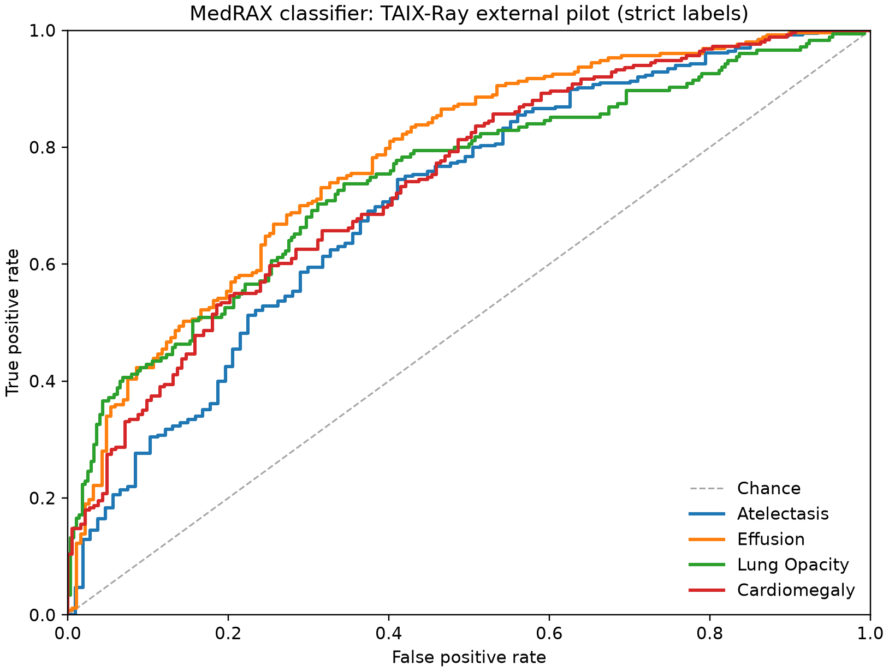

# MedRAX CXR classifier × TAIX-Ray

[](https://github.com/asharma391/medrax-taixray-external-validation/actions/workflows/test.yml)

A transparent, data-free external-validation pilot of the
[`ChestXRayClassifierTool`](https://github.com/bowang-lab/MedRAX) configuration
used by MedRAX, conducted on the 2026 public [TAIX-Ray](https://doi.org/10.1038/s41597-026-07271-7)
test split. The project also documents and fixes a real input-compatibility
blocker: unmodified MedRAX assumes all PNGs are 8-bit and rejects TAIX-Ray's
valid `uint16` images before inference.

> This is a tool-level external-validation pilot—not an evaluation of the full
> GPT-orchestrated MedRAX agent, a diagnostic system, or a clinical validation.



## What was completed

1. Audited MedRAX at commit [`d243cc5`](https://github.com/bowang-lab/MedRAX/tree/d243cc50348fa0f0c219cc623e2cf26b906be676) and reproduced the 16-bit input failure using a public TAIX-Ray image.
2. Published a tested, conservative [compatibility patch](https://github.com/asharma391/MedRAX): explicit high-bit-depth scaling, classifier-only `device="auto"` support (CUDA → MPS → CPU), and corrected score semantics.
3. Locked a **512-image, one-image-per-patient**, two-stage random-page pilot before viewing model outcomes. The candidate frame contained 6,400 official test rows from 64 uniformly sampled pages and 1,434 unique in-memory patient pseudonyms.
4. Ran the MedRAX-selected `torchxrayvision` `densenet121-res224-all` classifier on Apple MPS, checked image byte hashes, and reported only aggregate metrics with 2,000 bootstrap replicates.

## Primary result

TAIX grades 2–4 are “definite” findings; grade 0 is negative; grade 1
(questionable) is excluded. AUROC is the primary metric because the underlying
TorchXRayVision outputs are operating-point-normalized scores, not calibrated
probabilities.

| Endpoint | Evaluable n | Positive n | AUROC (95% bootstrap CI) | Average precision (95% CI) |
| --- | ---: | ---: | ---: | ---: |
| Atelectasis | 472 | 365 | 0.706 (0.649–0.762) | 0.873 (0.831–0.914) |
| Effusion | 440 | 253 | 0.778 (0.732–0.820) | 0.808 (0.754–0.861) |
| Lung Opacity | 451 | 175 | 0.744 (0.694–0.791) | 0.690 (0.624–0.758) |
| Cardiomegaly / enlarged heart size | 434 | 251 | 0.740 (0.697–0.785) | 0.797 (0.751–0.843) |

The complete [aggregate results](results/RESULTS.md) include the
pre-specified ordinal-label sensitivities and a descriptive two-encoding
diagnostic. The latter is not a causal claim: acquisition and cohort factors
may differ between the 0–4095 and wider-range `uint16` image strata.

## Why this is useful

The original classifier line is effectively:

```python
xrv.datasets.normalize(img, 255)
```

TAIX-Ray's public images include `uint16` PNGs, so the call raises before
model inference. The [patch](https://github.com/asharma391/MedRAX) preserves
the upstream `uint8` path and refuses ambiguous wider-integer input unless an
explicit intensity scale is supplied. It deliberately does **not** normalize
each image by its own maximum, because that would silently change image
contrast and conceal an acquisition-format assumption.

For TAIX-Ray, the audit uses a fully documented range rule: images with
observed maxima ≤4095 use a 4095 scale; wider-range `uint16` images use 65535.
This is a reproducibility convention for the public PNG export, not a claim
that lost DICOM bit-depth metadata has been recovered.

## Reproduce

Requirements: Python 3.11–3.13, internet access to the public TAIX-Ray dataset
viewer, and sufficient local storage for the private temporary image cache. A
GPU is not required for the classifier-only run; `--device auto` uses CUDA,
then Apple MPS, then CPU.

```bash
git clone https://github.com/asharma391/medrax-taixray-external-validation.git
cd medrax-taixray-external-validation
uv sync --extra dev
uv run medrax-taixray-audit all \
  --n 512 --page-budget 64 --seed 20261107 \
  --cache-dir .cache/taixray_pilot \
  --manifest results/pilot_manifest.json \
  --predictions results/predictions.json \
  --output-dir results --bootstrap-repetitions 2000 --device auto
uv run pytest
```

The CLI has separate `fetch`, `infer`, and `evaluate` stages. This permits a
reviewer to inspect the locked cohort manifest before inference. Public dataset
rate limits are respected with page caching and backoff.

## Data and ethics policy

This repository intentionally contains **no TAIX-Ray images, report text,
patient/physician identifiers, signed image URLs, or row-level labels/scores**.
Those local artifacts are ignored by Git. The public result includes only
aggregate metrics, a derived ROC figure, software versions, a model checkpoint
hash, dataset revision, sample-design counts, and encoding-stratum counts.

TAIX-Ray is CC-BY-4.0, but its data-use notice prohibits re-identification and
states that it is for research rather than clinical decision-making. Nothing in
this repository is medical advice or suitable for clinical use.

## Documentation

- [Protocol](docs/protocol.md): frozen provenance, outcome definitions,
  sampling design, uncertainty, ethics, and limitations.
- [Project-selection audit](docs/project-selection.md): why MedRAX was a
  verifiable primary contribution while BioReason and dnaHNet were not used for
  unsupported performance claims.
- [Aggregate results](results/RESULTS.md): primary, sensitivity, and
  encoding-stratified findings.
- [Compatibility patch](https://github.com/asharma391/MedRAX): direct fork of
  MedRAX with unit-tested input/device/score-semantics changes.

## Important limitations

- The pilot is not the full 42,928-radiograph TAIX-Ray test split.
- TAIX labels are structured routine radiologist-report grades, not consensus
  image re-reads.
- “External” means a 2026 public release from an external German ICU site; it
  does not prove absence of every possible pretraining overlap.
- The tested component is one classifier tool, not MedRAX's LLM agent, tool
  selection, or medical reasoning system.

## Citation

If this audit is useful, please cite the original MedRAX and TAIX-Ray work
alongside this repository. See [CITATION.cff](CITATION.cff).
